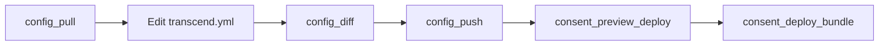

# @transcend-io/mcp-server-config

Pull and push `transcend.yml` files from MCP tools. Same behavior as `transcend inventory pull` and `transcend inventory push`.

These tools read and write files on your machine, so they run over `stdio` only. The hosted HTTP server does not list them.

## Tools

| Tool                  | What it does                                                                                                            |
| --------------------- | ----------------------------------------------------------------------------------------------------------------------- |
| `config_pull`         | Writes the organization configuration to an absolute `.yml` path. Returns counts.                                       |
| `config_diff`         | Dry-run preview: pull live state, diff the file, return a fenced diff for chat. Read-only.                              |
| `config_push`         | Pushes a `.yml` file to Transcend. Run `config_diff` first. Needs confirmation with a change summary.                   |
| `config_preview_push` | Structured dry-run summary and diff (like `transcend inventory push --dry-run`). Read-only.                             |
| `config_get_schema`   | Section catalog by default; pass `resources` for partial schema, or `includeFullSchema` for the full file (very large). |

## Run

```bash
npx -y @transcend-io/mcp-server-config
```

Auth works like the other MCP servers. See the [MCP README](../README.md).

## OAuth scopes

By default the server requests every scope that the pull and push paths can need.

Set `TRANSCEND_CONFIG_RESOURCES` to a comma-separated list of section names (for example
`dataSilos,purposes,consentManager`) to narrow OAuth sign-in and reject pull/push calls for
other sections. Unknown names fail at server startup. When the allowlist is set, `config_pull`
defaults and `resources: ["all"]` pull only those sections.

## Consent as code

Keep your consent setup in a `transcend.yml` file in git. Use an agent to pull it, edit it, preview the change, and push it.



The first four steps use this server. The last two use the [consent server](../mcp-server-consent/README.md). A push saves settings. Only a deploy changes what site visitors load.

### Steps

1. **Pull.** Call `config_pull` with an absolute `filePath` that ends in `.yml` or `.yaml`. Pass the sections you need in `resources`. The default sections are `dataSilos`, `enrichers`, `templates`, and `apiKeys`, so pass `resources` for consent work. The call fails if the file exists unless you pass `overwrite: true`. It returns section counts, not file contents.
2. **Edit.** Read the file and change it. Call `config_get_schema` with `resources` (for example `["consentManager"]`) to see the allowed keys. Call it with no arguments to see the section catalog.
3. **Preview.** Call `config_diff`. It pulls live state, compares it to your file, and returns a fenced diff. It also lists side effects, such as live domains the push would remove. `config_preview_push` returns a similar summary and diff in a different format. Both are read-only.
4. **Push.** Call `config_push` with the same `filePath`. Your client asks you to confirm. The confirmation shows a change summary.
5. **Deploy.** Call `consent_preview_deploy`, then `consent_deploy_bundle`, with the consent server. Both take `environment`: `TEST` or `PRODUCTION`. Deploy `TEST` first.

Empty sections in the file are skipped. If the file has `<<parameters.name>>` placeholders, pass a value for each one in `variables`.

### Example prompts

```text
Pull my consent manager, purposes, data flows, cookies, and consent sites into
/Users/me/transcend/transcend.yml. Overwrite the file if it exists.
```

```text
In transcend.yml, add app.example.com to consent-manager domains. Run config_diff
and show me the diff. Do not push yet.
```

```text
Set unknownRequestPolicy to REQUIRE_FULL_CONSENT and unknownCookiePolicy to ALLOW.
Run config_diff, then wait for my approval before config_push.
```

```text
The diff looks right. Push it. Then run consent_preview_deploy for TEST and show me the result.
```

### Narrow the server to consent sections

Set `TRANSCEND_CONFIG_RESOURCES` so the server asks for consent scopes only and rejects other sections:

```bash
TRANSCEND_CONFIG_RESOURCES=consentManager,purposes,dataFlows,cookies,consentSites
```

With this set, a bare `config_pull` pulls those five sections. A file that contains any other section fails on `config_push`.

| Section name     | Key in `transcend.yml` |
| ---------------- | ---------------------- |
| `consentManager` | `consent-manager`      |
| `purposes`       | `purposes`             |
| `dataFlows`      | `data-flows`           |
| `cookies`        | `cookies`              |
| `consentSites`   | `consent-sites`        |

For a full file to copy from, see [`consent-as-code.yml`](../../cli/examples/consent-as-code.yml) in the CLI examples.

### One server entry per organization

An OAuth client belongs to one organization. For each organization, create its own OAuth client. Give each entry a unique `TRANSCEND_OAUTH_REDIRECT_PORT`, and register `http://127.0.0.1:{port}/callback` on that client. See [OAuth client setup](../README.md#oauth-client-setup).

```json
{
  "mcpServers": {
    "transcend-staging": {
      "command": "npx",
      "args": ["-y", "@transcend-io/mcp"],
      "env": {
        "TRANSCEND_OAUTH_CLIENT_ID": "staging-client-id",
        "TRANSCEND_OAUTH_CLIENT_SECRET": "staging-client-secret",
        "TRANSCEND_OAUTH_REDIRECT_PORT": "4601",
        "TRANSCEND_MCP_SERVERS": "config,consent",
        "TRANSCEND_CONFIG_RESOURCES": "consentManager,purposes,dataFlows,cookies,consentSites"
      }
    },
    "transcend-production": {
      "command": "npx",
      "args": ["-y", "@transcend-io/mcp"],
      "env": {
        "TRANSCEND_OAUTH_CLIENT_ID": "production-client-id",
        "TRANSCEND_OAUTH_CLIENT_SECRET": "production-client-secret",
        "TRANSCEND_OAUTH_REDIRECT_PORT": "4602",
        "TRANSCEND_MCP_SERVERS": "config,consent",
        "TRANSCEND_CONFIG_RESOURCES": "consentManager,purposes,dataFlows,cookies,consentSites"
      }
    }
  }
}
```

Give each organization one MCP server entry. Tell the agent which organization to use by server name. Use a separate `filePath` per organization.

### Rules that prevent damage

- **A push replaces the whole `consent-manager.domains` list.** Domains that are live but missing from your file are removed. Pull first and edit the list. `config_diff` reports this as a side effect.
- **A push does not deploy.** Visitors keep loading the old bundle until you call `consent_deploy_bundle`. `PRODUCTION` is the live bundle.
- **`default-consent` is ignored on push.** Purposes in the `purposes` section never write it, on create or on update. Change it in the dashboard.
- **Built-in purposes keep some fields.** For built-in purposes, push does not write `configurable` or `show-in-consent-manager`. It logs a warning.
- **Set `unknownRequestPolicy` when you set `unknownCookiePolicy`.** The push only applies `unknownCookiePolicy` when `unknownRequestPolicy` is also in the file.
- **`version` is write-only.** Pull does not return it. Add it by hand to pin the airgap.js version.
- **Some keys are pull-only.** Push ignores `bundleUrls`, `syncEndpoint`, `syncGroups`, and `prefixModules` under `consent-manager`. Push also ignores `owners` and `teams` on `data-flows` and `cookies`.
- **Other consent lists are not pruned.** Purposes, consent sites, data flows, and cookies that are missing from the file stay in place. The domain list is the exception.
- **Experience purposes use `trackingType`.** Each entry in `consent-manager.experiences[].purposes` and `optedOutPurposes` needs the purpose slug as `trackingType`.
